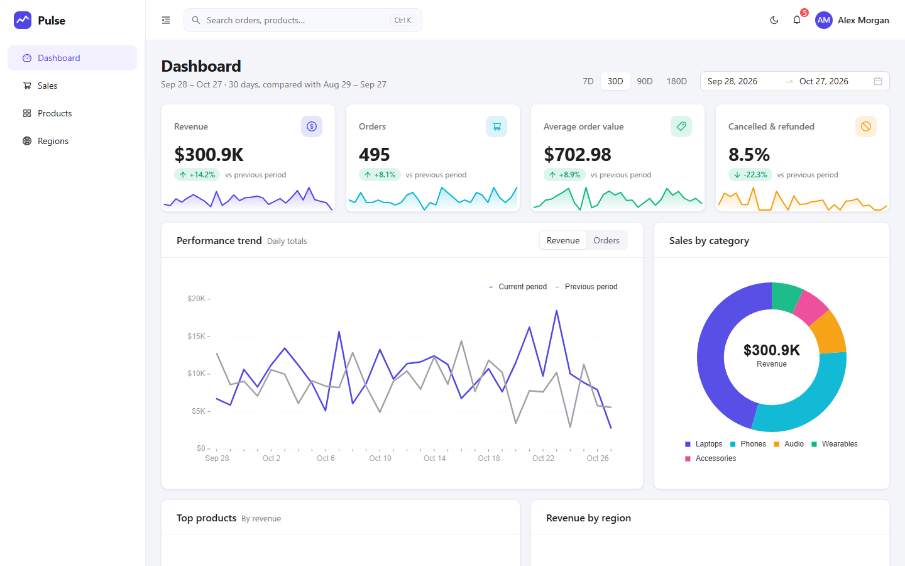
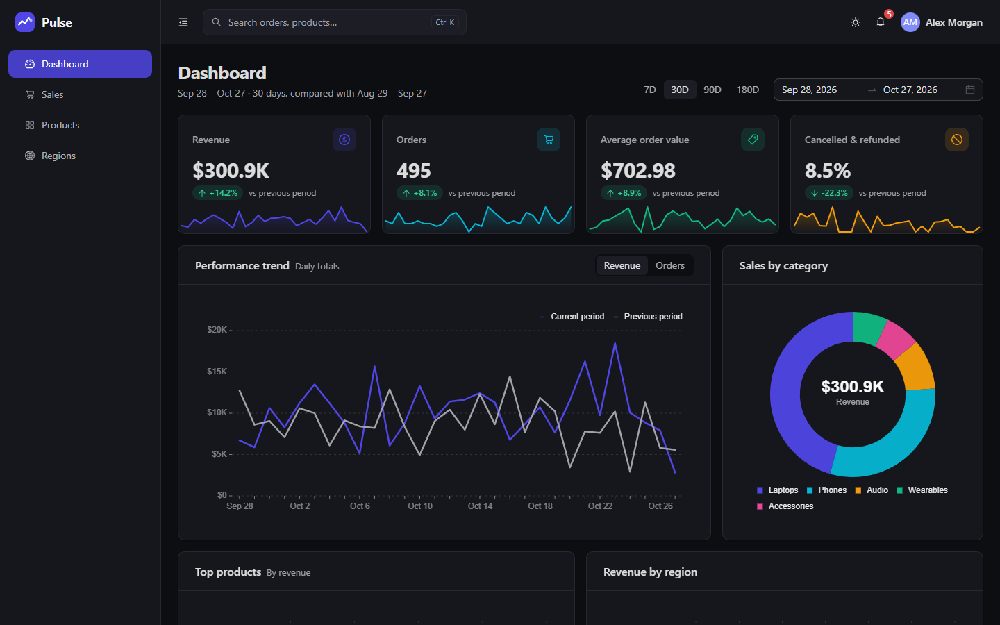
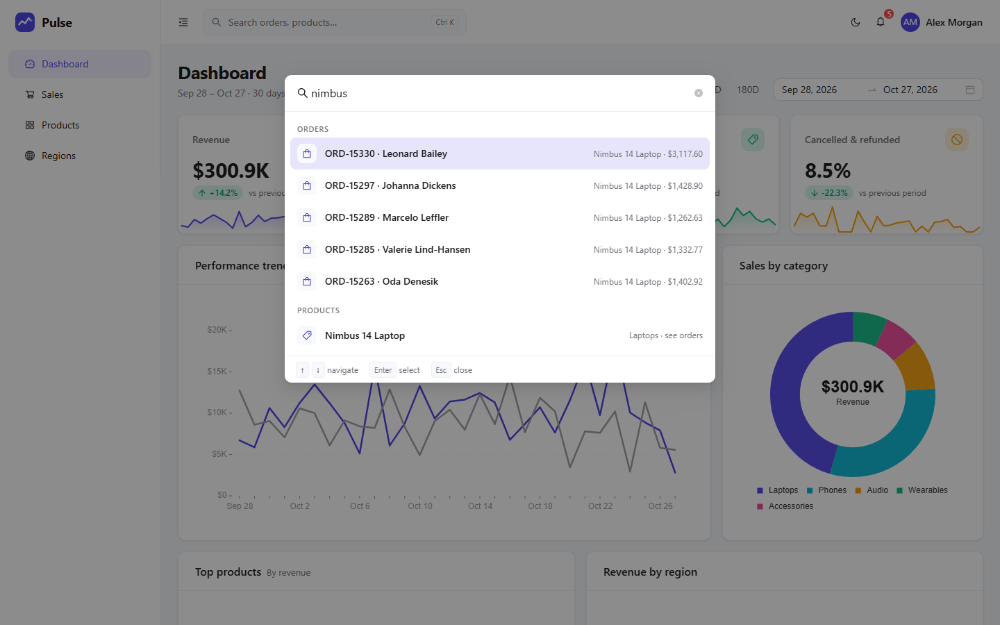
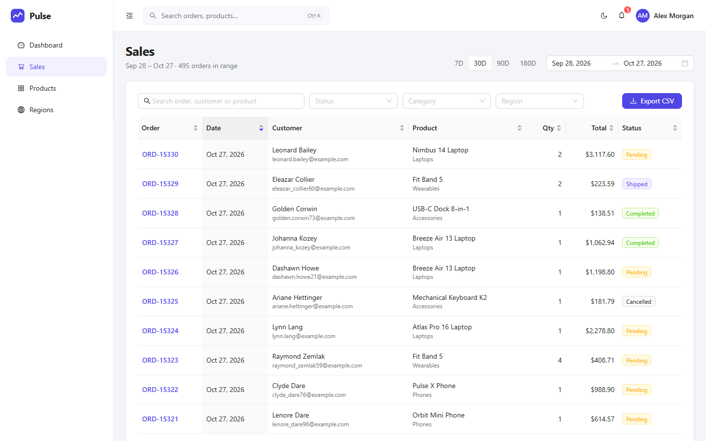
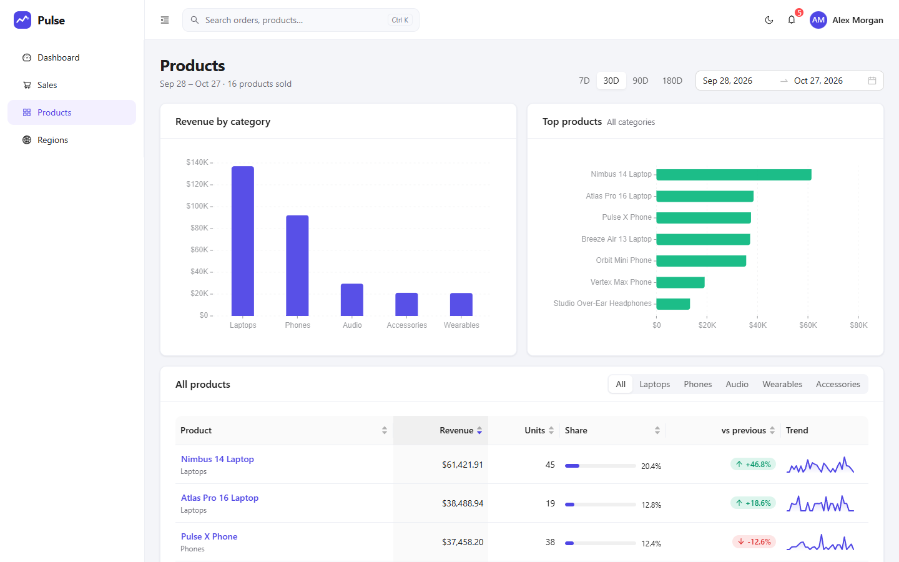

# Pulse – React Admin Dashboard

A sales analytics dashboard built with **React 19, TypeScript, Vite and Ant Design**. It turns a deterministic mock data set into KPI cards with sparklines, period-over-period comparisons, trend and breakdown charts, a server-style orders table, a command palette and a light/dark theme.

**Live demo:** https://arifaydin12.github.io/react-admin-dashboard/



<table>
  <tr>
    <td></td>
    <td></td>
  </tr>
  <tr>
    <td></td>
    <td></td>
  </tr>
</table>

## Features

- **Global date range** (7 / 30 / 90 / 180 days or any custom range) that filters every page; every figure is compared with the previous period of equal length.
- **Dashboard**: revenue, orders, average order value and cancellation-rate KPIs with sparklines and deltas, a revenue/orders trend line with the previous period overlaid, sales by category, top products, revenue by region and the latest orders.
- **Sales**: filter by text, status, category and region (kept in the URL), sort by any column, paginate, open an order in a detail drawer (totals and fulfilment timeline) and **export the current result set to CSV**. Data is fetched through a small async query layer, so the table behaves like a server-driven one (loading states, total counts, page clamping).
- **Products**: per-product revenue, units, share, trend sparkline and change versus the previous period, with a category filter.
- **Regions**: donut and bar charts, a region × category heat grid and a breakdown table.
- **Command palette** (`Ctrl`/`⌘` + `K`): jump to pages, run actions (theme, date range, settings…) and search orders and products.
- **Notification centre**: insights are derived from the data (revenue trend, stuck pending orders, cancellation rate, best seller…), with read/dismiss state persisted in `localStorage` and deep links into the filtered views. Exporting a CSV adds a notification too.
- **Settings**: display name, theme, rows per page, compact numbers and chart animation – all persisted.
- **Light / dark theme** (follows the OS on first visit, then remembers your choice), collapsible sidebar, responsive layout with a mobile navigation drawer.
- **Resilience and accessibility**: skeleton loading states, empty states, an error boundary around the app, routes and every chart, skip link, keyboard-operable palette (`combobox`/`listbox` roles), focus styles, `prefers-reduced-motion` support.
- **Performance**: lazy-loaded routes, charts and overlays; the entry chunk is about 23 kB (the charting engine and the mock-data generator load on demand).

## Tech stack

| Area | Tools |
| --- | --- |
| Framework | React 19, React Router 7 (`HashRouter`) |
| Language | TypeScript 5 (strict) |
| UI | Ant Design 5, `@ant-design/charts`, a small SVG sparkline component |
| Data | `@faker-js/faker` with a fixed seed, `dayjs` |
| Tooling | Vite 7, ESLint 9, Vitest, React Testing Library |

## Getting started

```bash
git clone https://github.com/arifaydin12/react-admin-dashboard.git
cd react-admin-dashboard
npm install
npm run dev
```

Open the URL printed by Vite (usually `http://localhost:5173`).

| Script | What it does |
| --- | --- |
| `npm run dev` | Start the dev server with hot reload |
| `npm run build` | Type-check and create a production build in `dist/` (git-ignored) |
| `npm run build:pages` | Type-check and build into `docs/` (emptied first) for GitHub Pages |
| `npm run preview` | Serve the production build locally |
| `npm run lint` | Run ESLint |
| `npm run typecheck` | Run the TypeScript project build (`tsc -b`) |
| `npm test` | Run the unit and component tests once (Vitest) |
| `npm run test:watch` | Run Vitest in watch mode |

## Mock data

All data is generated in the browser by `src/data/generate.ts`: about a year of orders (roughly 5,000) for a 16-product catalogue, with an upward trend, a weekly rhythm, regional weights, discounts, shipping and tax. The generator is seeded (`faker.seed`), so the same seed and end date always give identical orders and the charts are stable. The history always ends on the current day, so the default "last 30 days" view is never empty. Currency and locale (USD, `en-US`) are defined once in `src/lib/format.ts`.

To use real data, replace the dynamic import in `src/context/DataContext.tsx` and the simulated latency in `src/hooks/useOrdersQuery.ts` with API calls; the aggregation helpers in `src/lib/analytics.ts` are pure functions and do not depend on where the orders come from.

## Deployment (GitHub Pages)

The site is served from the committed `docs/` folder, so no GitHub Actions workflow is needed.

```bash
npm run build:pages   # builds into docs/ with relative asset paths
```

Then commit `docs/` and, in the repository settings, set **Pages → Source** to *Deploy from a branch* → `main` → `/docs`. The build uses `base: './'` and `HashRouter`, so it works from any sub-path (such as `/react-admin-dashboard/`) and deep links survive a refresh. `docs/` is generated – do not edit it by hand; `dist/` stays git-ignored.

## Project structure

```
src/
  components/   KpiCard, Sparkline, ChartCard, CommandPalette, OrderDrawer, NotificationDrawer,
                SettingsModal, DateRangeControl, HeatGrid, StatusTag, ErrorBoundary,
                charts/ (lazy Trend, Donut and Bar charts)
  context/      Theme, Settings, Data, Filter (date range) and Notification providers
  data/         Product catalogue and the seeded order generator
  hooks/        useAnalytics, useOrdersQuery, useModHotkey
  layout/       AppLayout (sidebar, header, overlays), navigation, page skeleton
  lib/          Pure helpers: analytics, format, csv, insights, search, dates, storage
  pages/        Dashboard, Sales, Products, Regions, NotFound
  styles/       Global CSS and design tokens (light and dark)
  test/         Test setup and fixtures
```

## Testing

`npm test` runs 69 tests: aggregation and query helpers (ranges, summaries, deltas, series, breakdowns, filtering, sorting, pagination), the seeded generator (determinism, consistency), formatting, CSV export, insights and search, plus component tests for the KPI card, sparkline, status tag, error boundary, command palette and theme persistence.

## License

[MIT](LICENSE) © Arif Enes Aydin
