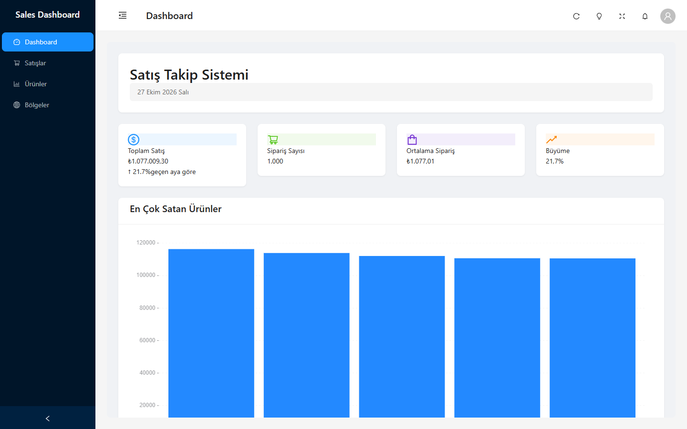
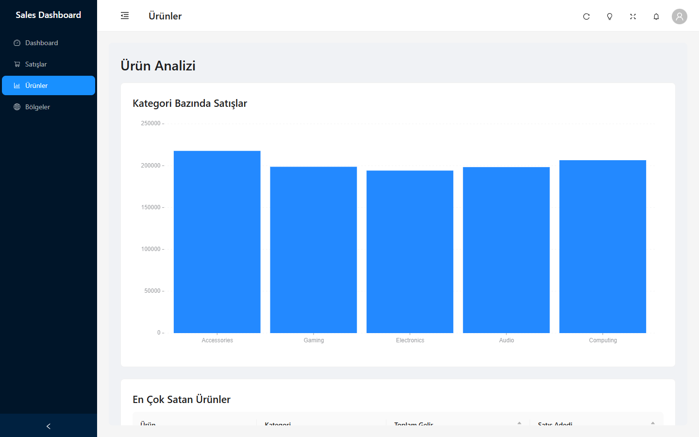
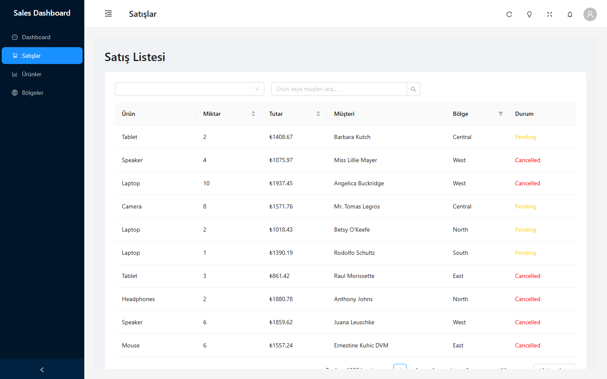

# React Admin Dashboard

A sales analytics dashboard built with **React 19, TypeScript, Vite and Ant Design**. It includes KPI cards, interactive charts, filterable data tables, a notification centre, user settings and a light/dark theme.



<table>
  <tr>
    <td></td>
    <td></td>
  </tr>
</table>

## Features

- **Overview page** with KPI cards (total sales, order count, average order value, growth) and a top-products chart
- **Sales page**: sortable and filterable table with search by product or customer, status tags and pagination
- **Products page**: category sales chart and a top-sellers table
- **Regions page**: regional sales distribution with a pie chart
- **Notification centre** in a drawer, plus toast notifications
- **User settings** modal with persisted preferences
- **Global search**, fullscreen mode, sidebar collapse and keyboard shortcuts
- **Light and dark theme** via a shared dashboard context
- Typed end to end with TypeScript; sample data generated with `@faker-js/faker`

## Tech stack

| Area | Tools |
| --- | --- |
| Framework | React 19, React Router 7 |
| Language | TypeScript 5 |
| UI | Ant Design 5, Ant Design Charts |
| Build | Vite, ESLint |
| State | React Context |

## Getting started

```bash
git clone https://github.com/vaas125/react-admin-dashboard.git
cd react-admin-dashboard
npm install
npm run dev
```

Open the URL printed by Vite (usually `http://localhost:5173`).

| Script | What it does |
| --- | --- |
| `npm run dev` | Start the dev server with hot reload |
| `npm run build` | Type-check and create a production build in `dist/` |
| `npm run preview` | Serve the production build locally |
| `npm run lint` | Run ESLint |

## Project structure

```
src/
  components/   StatCard, SearchBar, NotificationCenter, UserSettingsModal
  context/      DashboardContext (theme, sidebar, refresh state)
  config/       Default user settings
  data/         Mock data generators
  layouts/      MainLayout (sidebar, header, drawer)
  pages/        Dashboard, Sales, Products, Regions
  types/        Shared TypeScript types
  utils/        Helpers and hooks (useWindowSize, useKeyPress)
```

## Notes

The data is generated locally and is not connected to a backend. To use real data, replace the generators in `src/data/mockData.ts` with API calls.

The interface is in Turkish.

## License

[MIT](LICENSE) © Arif Enes
